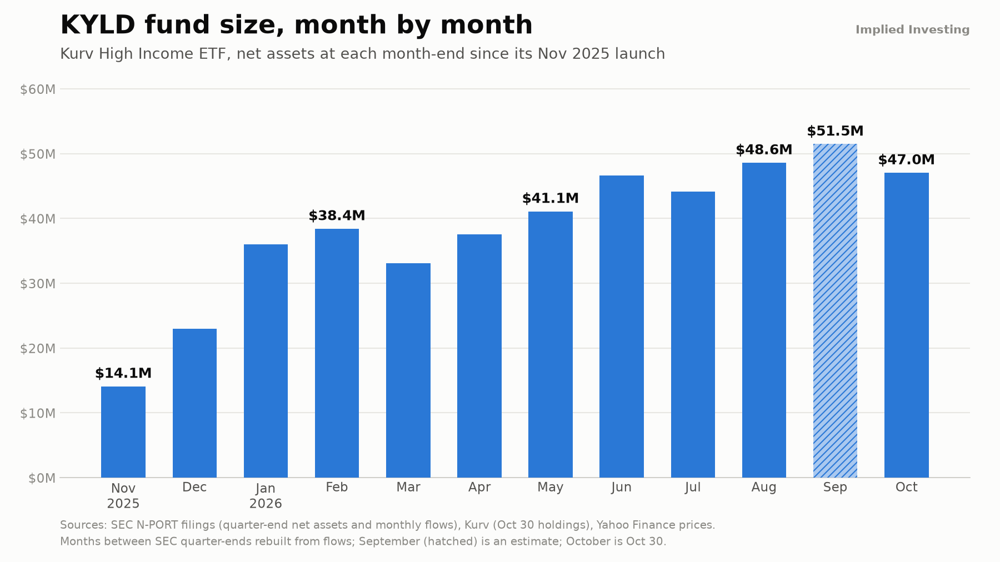

# Implied Investing — selected code

[Implied Investing](https://impliedinvesting.com) is my investing-education site and YouTube channel for self-directed income investors. I designed, built and run the whole stack myself: a Python web server, member accounts with Stripe billing, a live options-signal engine and an "Income Lab" that tracks 170 option-income ETFs from 13 issuers.

The full application is in a private repository, because it holds the members-only strategy and billing code. This repository is a selected, public-safe slice of it.

## What's here

### Income Lab data pipeline — `site/lab/`
An automated refresh job that keeps the site's ETF comparison tool current without anyone touching it.

- **`refresh.py`** has two schedules:
  - **Daily:** closing prices and distributions for every fund plus the SPY and QQQ benchmarks.
  - **Weekly:** top-10 holdings and distribution rates from each fund issuer.
- **`fetchers/`** has one module per issuer: YieldMax, REX, Kurv, NEOS, Amplify, Goldman Sachs, J.P. Morgan, GraniteShares, Overlay Shares, Tuttle, TappAlpha, Quantify and others.
  - Each one reads that issuer's own published feed: CSV, JSON, XML or HTML.
  - It normalizes the data to one shape.
- **Fault tolerant:**
  - If one issuer's site changes or goes down, that fund keeps its last good values and gets flagged in a report.
  - Nothing is ever fabricated.

### YouTube feed — `site/youtube_feed.py`
- The home page shows the channel's newest uploads automatically.
- It reads YouTube's Atom feed first and falls back to the channel page's embedded data.
- Results are cached, and it keeps the last good list if both sources fail.
- Covered by offline tests in `site/tests/`.

### Research example — `research/kyld_aum/`
- Rebuilds an ETF's month-by-month fund size from SEC N-PORT filings.
- Uses quarter-end net assets plus monthly creation and redemption flows, pinned to the filed share counts.
- Produces a publication-ready chart.



## The rest of the system (private)

- **Web server:** a threaded Python HTTP server with a JSON API and a single-page front end.
- **Accounts:**
  - scrypt password hashing
  - HttpOnly SameSite session cookies
  - CSRF tokens with a same-origin check
  - login throttling
- **Billing:**
  - Stripe Checkout and the Customer Portal; card data never touches the server.
  - Signed, idempotent webhooks are the only thing that changes a member's tier.
- **Implied Edge:**
  - A rules-based options-signal engine that scans live delayed option chains (Cboe, Yahoo) at click time.
  - Returns either a priced trade ticket or a plain-English "no trade" reason. It never places orders.
- **Hosting:** deployed on Render with auto-deploy from `main`.

## Run

```bash
python site/tests/test_youtube_feed.py
python site/lab/refresh.py prices --out ./out
```

Python 3, standard library first. `matplotlib` is used for the chart.
